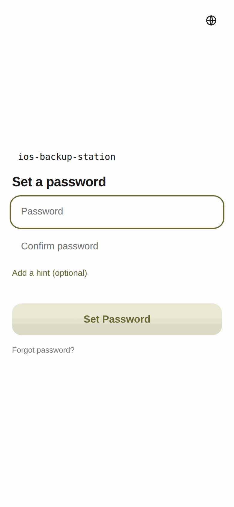
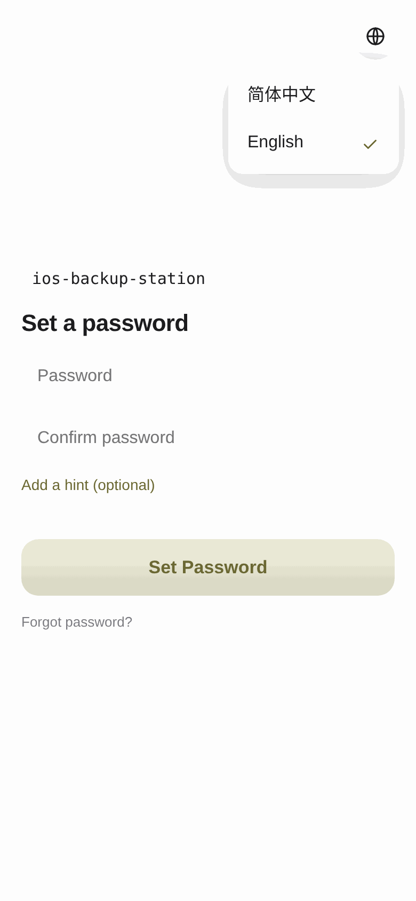
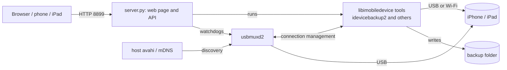

# ios-backup-station

**English** · [简体中文](README.zh-CN.md)

Back up your iPhone and iPad **to your own NAS, over Wi-Fi or USB**, and manage it from a web page. The backups are full, optionally encrypted device backups in the same folder layout iTunes and Finder use.

<p align="center"></p>

<p align="center"><a href="docs/video/ios-backup-station-demo.mp4"></a><br><sub>▶ Watch the 3-minute demo (no sound, captions in Chinese and English)</sub></p>

> Not affiliated with Apple. Please read the [disclaimer](#5-disclaimer-and-tested-setup) first, **especially the part about what has not been verified yet**.

## Contents

1. [What it is and why](#1-what-it-is-and-why)
2. [Install](#2-install)
3. [Features (screenshots)](#3-features-screenshots)
4. [Permissions it needs](#4-permissions-it-needs)
5. [Disclaimer and tested setup](#5-disclaimer-and-tested-setup)
6. [Known limitations](#6-known-limitations)
7. [Troubleshooting](#7-troubleshooting)
8. [Restoring a backup](#8-restoring-a-backup)
9. [Upgrade, uninstall, back up the settings](#9-upgrade-uninstall-back-up-the-settings)
10. [Security and privacy](#10-security-and-privacy)
11. [How it compares](#11-how-it-compares)
12. [How it works](#12-how-it-works)
13. [Development and tests](#13-development-and-tests)
14. [Credits and license](#14-credits-and-license)
15. [Support](#15-support)

---

## 1. What it is and why

**I did not want to hand my phone backups to iCloud, and I did not want to keep a computer switched on with a cable plugged in.**

- iCloud backups can only go to Apple's servers, and the storage costs extra.
- Wireless sync in iTunes or Finder needs a computer that stays on.
- Most people with a NAS already have lots of space on something that never sleeps.

So this project lets the NAS do the backup itself:

- The NAS talks to the iPhone or iPad over USB or Wi-Fi with [libimobiledevice](https://libimobiledevice.org) and usbmuxd2, the same backup protocol iTunes uses.
- Backups can be **encrypted**. Each device gets a folder named after its UDID, the layout iTunes and Finder use, so you can copy it to a Windows PC or a Mac to restore (see [Restoring a backup](#8-restoring-a-backup)).
- A **web interface** (desktop and phone layouts, works on iPad) sets the backup location and encryption, runs **scheduled backups**, and shows progress and history.
- It is **one Docker container**, started with `docker compose up`.

It is for you if you have a NAS or small server that runs Docker, has a USB port, and sits on the same LAN as your phone.

## 2. Install

### What you need

| Requirement | Notes |
|---|---|
| A Linux NAS or mini server | Tested on x86_64 fnOS, see [tested setup](#5-disclaimer-and-tested-setup) |
| Docker and Docker Compose v2 | `docker compose version` must work |
| A USB port | Pairing and the first full backup are best done over USB |
| avahi on the host (optional) | Only Wi-Fi backups need it; USB backups work without |
| A folder for the backups | With enough space: a full device backup can be tens to hundreds of GB |

### Easiest: the installer

```bash
git clone https://github.com/JerryGHT04/ios-backup-station.git
cd ios-backup-station
./install.sh
```

The script checks Docker, **suggests the location with the most free space**, makes sure the folder exists and is writable, writes `.env`, starts the container and prints the address. The first start builds from source on the NAS and takes a few minutes.

If you run `docker compose up` before there is a `.env`, it stops and tells you what is missing:

```text
required variable BACKUP_LOCATION is missing a value: Set BACKUP_LOCATION in .env first: the full path of the NAS folder where backups are stored ...
```

### Manual install

```bash
cp .env.example .env
# edit .env. Only BACKUP_LOCATION is required: the full path of an existing folder for the backups
docker compose up -d --build
```

Settings in `.env`:

| Variable | Default | Meaning |
|---|---|---|
| `BACKUP_LOCATION` | required | NAS folder for the backups, for example `/volume1/ios-backups` |
| `PORT` | `8899` | Port of the web page |
| `CONFIG_LOCATION` | `./config` | Settings, web password, history. **Keep it.** |
| `LOCKDOWN_LOCATION` | `./lockdown` | Pairing records of your devices. **Keep it**, otherwise you pair again. |
| `APT_MIRROR` | empty | Build with a mirror if downloads are slow, for example `mirrors.ustc.edu.cn` |
| `IBS_IMAGE` | empty | A prebuilt image (once one is published), skips the build on the NAS |

### From a NAS Docker app

On fnOS the project shows up in the Docker app's Compose list after you start it with the commands above, where you can inspect and stop it. To edit the compose file in the GUI, stop the project first; it edits the same file.

### First use

1. Open `http://NAS-IP:8899` in a browser on the same LAN and **set a password** (typed twice, hint optional).
2. Connect the iPhone or iPad to the NAS with a USB cable, tap Trust on the device and enter its passcode.
3. The page asks you to **choose the backup folder** (it suggests the disk with the most free space).
4. Do the first backup **over USB, in one go**, and decide about encryption then.
5. For Wi-Fi backups: while on USB, tap Turn On Wi-Fi Sync in Connection & Pairing; on the device go to Settings, Wi-Fi, your home network, ⓘ and **turn off Private Wi-Fi Address** (why: see [Troubleshooting](#7-troubleshooting)); unplug USB and tap Check Connection.
6. For nightly backups, set a schedule.

The **Setup check** on the page tells you what is still missing, for example when the backup folder is not really mounted into the container.

## 3. Features (screenshots)

### Password and language

The first visit sets a password; after that you type it once. Two wrong attempts show the hint you set. On the phone layout a small icon on the password screen switches between English and Simplified Chinese.

<table>
<tr>
<td></td>
<td></td>
<td></td>
</tr>
</table>

### Summary and backup

The status bar shows the connection and the last backup. Back Up Now starts a backup; the progress bar (and the ring on the phone layout) shows the **overall** progress, not the progress of single files, with elapsed time and an estimate of the time left. Cancelling needs a second tap to confirm and leaves the last good backup untouched.

<table>
<tr>
<td></td>
<td></td>
</tr>
</table>

**Delete backup** removes the whole backup of the selected device from the NAS (you type a confirmation word first; it is refused while a backup runs). **Switch device** appears next to the device name on the desktop layout when more than one iPhone or iPad is visible; it is locked while a task runs.

*The desktop layout is Chinese only for now; the phone layout is available in English and Simplified Chinese. An English desktop layout is on the roadmap.*

### History, schedule, connection

- **Backup history**: time, way (USB or Wi-Fi), trigger (manual or scheduled), size, duration, encryption, and the reason for a failure.
- **Scheduled backup**: the NAS connects to the device at the set time. If the device is offline it retries every 10 minutes inside the window you choose; if a locked device waits for its passcode for more than 5 minutes the attempt is abandoned. It uses the NAS's own time zone.
- **Connection & pairing**: the steps for pairing, turning on Wi-Fi sync and checking the connection, plus an explanation of why Private Wi-Fi Address has to be off.

<table>
<tr>
<td></td>
<td></td>
<td></td>
</tr>
</table>

### Choosing the folder, and the Setup check

The folder picker shows only the **folders you shared with the container** and can create new ones; each device can have its own folder (one for the iPhone, one for the iPad). The Setup check points out when the backup folder is not really mounted, pairing records are not persisted, or USB or avahi cannot be found, and says how to fix it.

<table>
<tr>
<td></td>
<td></td>
</tr>
</table>

### Phone and iPad

Phones and iPads automatically get a layout made for touch, modelled on Apple's Diagnostics app: one thing per screen, a progress ring, cards, details sliding up from the bottom. If you tap Request Desktop Website on a phone you get the desktop layout. The phone layout is in English and Simplified Chinese.

<table>
<tr>
<td></td>
<td></td>
<td></td>
<td></td>
</tr>
</table>

<p align="center"></p>

### Try the interface without a phone

```bash
python3 tests/run_demo_server.py     # open http://127.0.0.1:8899, password: demo
```

This is the real server with a fake phone and sample data. It is deleted when you stop it and touches nothing else.

## 4. Permissions it needs

The container has to deal with USB devices, the LAN and the system's avahi, so it needs more than an ordinary app. **Please understand this before installing.**

| Setting | Why | What it means |
|---|---|---|
| `privileged: true` | Access USB devices, make usbmuxd work | A program in the container is effectively root on the NAS. Run it only on a trusted LAN, never expose it to the internet |
| `network_mode: host` | Find the phone on the LAN (mDNS) and reuse the host's avahi | The container uses the host's network; the web port (default 8899) opens on the host |
| `/dev/bus/usb` | USB pairing and backups | The container can see all USB devices |
| `/run/dbus`, `/run/avahi-daemon` | Find phones on Wi-Fi through the host's avahi | The container can talk to the host's avahi service. Without avahi only Wi-Fi backups are affected |
| `/etc/localtime` (read-only) | Scheduled backups use the NAS's time zone | None |
| `BACKUP_LOCATION` (read-write) | Store the backups | The container can read and write this folder only, no other folders |
| `./config`, `./lockdown` (read-write) | Store settings, the password hash and pairing records | `lockdown` holds trust keys of your devices: treat it like a password and do not copy it around |

The container runs as root. At run time it **does not need internet access** (building does: it downloads from GitHub and Debian). It **sends no telemetry**.

## 5. Disclaimer and tested setup

**Disclaimer**

- A hobby project, provided "as is" **without any warranty** (see [LICENSE](LICENSE)).
- Not affiliated with, authorized by or endorsed by Apple. iPhone, iPad, iOS, iTunes, Finder and macOS are trademarks of Apple Inc., used here only to say which devices and programs the software works with.
- A backup holds your most private data (photos, messages, health data, passwords). **Turn encryption on, keep the backup password safe, and try a restore from time to time.** A forgotten backup password cannot be recovered.
- It relies on a backup protocol implemented by third-party libraries. After an iOS update the protocol may change, and backups can fail or be incomplete.
- The author is not responsible for data loss.

**What has been tested (the author's setup)**

| Item | Details |
|---|---|
| NAS | fnOS (kernel 6.18), x86_64, 12 cores, 15.5 GiB RAM, btrfs storage |
| Docker | Docker 28.5.2, Compose v2.40.3, Debian 13 (trixie) base image |
| Device | iPhone Air (`iPhone18,4`), iOS 27.0.1, USB-C; an iPad was used to open the web interface |
| Network | Router with 2.4 GHz and 5 GHz, NAS on Ethernet |
| Browsers | Safari on an iPhone and an iPad; Chrome on Linux for the automated tests |
| Resource use | About 1% of one CPU core and about 19 MiB of RAM while idle |

**Verified on real hardware**: USB detection and pairing; turning on Wi-Fi sync; finding the phone over Wi-Fi and switching between USB and Wi-Fi; turning on backup encryption; opening the web interface on the phone and the iPad; starting and cancelling a backup; **complete encrypted backups over Wi-Fi and USB** (an iPhone, about 131 GB, and an iPad, about 33 GB); deleting a backup; and **that the device accepts the backup password and starts unpacking the backup** (`idevicebackup2 unback`, stopped after two minutes).

**Not verified yet (do not assume they work)**

- **Restoring a phone from a backup made by this tool.** The folder layout is the one iTunes and Finder use, the device unlocks the backup with its password and starts reading it, but a complete restore onto a phone has **not** been tried, and neither has unpacking the whole backup.
- Unattended nightly backups (in particular whether a locked phone asks for its passcode).
- Restoring an iPad. (Backing an iPad up works.)
- The automatic choice of layout when you tap Request Desktop Website, and the iPad getting the phone layout: the decision logic was tested in simulation, the behaviour on real devices has not been checked item by item.
- Other NAS brands (Synology, QNAP, Unraid, TrueNAS, ...), arm64, other iOS versions.

**Automated tests** (no device needed: a fake set of libimobiledevice commands drives the real server code): 34 API tests, 12 browser tests (sign-in, every screen, cancelling, XSS, no sideways scrolling at any width, every control has a name) and 26 pure-logic tests (schedule, watchdogs, progress parsing, self-check). See [Development and tests](#13-development-and-tests). They catch mistakes in our own logic but **are no substitute for real hardware**.

## 6. Known limitations

- **No resume.** If a backup is interrupted (the device leaves Wi-Fi, the cable is pulled, you leave home), the files already written stay, but next time the device compares again and sends what is needed; the interrupted part has to be sent again. Do the first full backup at home over USB in one go.
- **One device is handled at a time.** With several devices visible you pick one with the switcher next to the device name (desktop layout; the phone layout has none yet). Backups do not run in parallel, and a **scheduled backup only runs for the device that is selected**. Backup folder and schedule are stored per device.
- **A locked device may ask for its passcode.** Right after a restart, before the first unlock, a backup always asks; otherwise it depends on the device and has not been tried overnight yet.
- **No browsing of single files.** It is a full device backup that can only be restored as a whole.
- **Restoring cannot be done on the phone.** Use iTunes on Windows or Finder on a Mac.
- **The desktop layout is Chinese only for now.** The phone layout has English and Simplified Chinese.
- **The web page is plain HTTP, no TLS.** Only for the LAN, see [Security and privacy](#10-security-and-privacy).
- **Wi-Fi backups are slower than USB** and use Wi-Fi bandwidth. Do them at night.
- Since iOS 26.4 there is a device-side LAN connection problem that needs Private Wi-Fi Address turned off.

## 7. Troubleshooting

**The Setup check says the backup folder is not mounted**
The container cannot see your folder, so backups would be written inside the container and lost when it is removed. Check that `BACKUP_LOCATION` in `.env` is an existing path and run `docker compose up -d` to recreate the container.

**The NAS cannot find the phone over Wi-Fi**
1. Are they on the same network segment? Guest networks and some IoT networks isolate devices.
2. Is Wi-Fi sync on? (Turn it on while connected over USB.)
3. Turn off **Private Wi-Fi Address** for your home network (Settings, Wi-Fi, ⓘ next to the network). Since iOS 26.4, leaving it on makes the device unreliable on the LAN: the NAS sees it one moment and loses it the next. If your 2.4 GHz and 5 GHz networks have different names, do both.
4. A sleeping device may not answer. Charge it, or wake the screen and tap Check Connection.
5. Is avahi running on the host? The Setup check says so.

**The connection shown is wrong after switching Wi-Fi band or the USB cable**
usbmuxd2 sometimes does not rediscover a device, so the service has two watchdogs: a device on the USB bus that usbmuxd2 does not list gets usbmuxd2 restarted after 3 seconds; a phone that is reachable on the LAN but not listed after about 8 seconds (1 second right after a cable was pulled). Restarting usbmuxd2 takes about twenty seconds on real hardware, so the whole thing can take half a minute. Check Connection triggers it on demand.

**A backup starts and waits for "enter the passcode on the device"**
The device waits for you to unlock it and enter its passcode. A scheduled backup has nobody to do that and gives up after 5 minutes, then tries again.

**I forgot the web password**
Delete `config/auth.json` in the project folder on the NAS, restart the container and set a new one. This does **not** affect the backups or the backup password on the device.

**I forgot the backup password**
It cannot be recovered; that is how iOS works. Keep the backup password in a password manager.

**The build is slow or fails**
If deb.debian.org is slow, set `APT_MIRROR` in `.env` (for example `mirrors.ustc.edu.cn`). Docker registry mirrors sometimes answer 401; trying again usually works.

**The time is wrong**
Scheduled backups use the NAS's time zone; the compose file mounts `/etc/localtime`. Run `date` on the NAS to check.

## 8. Restoring a backup

Restoring is done on a computer; the phone cannot restore from the NAS directly.

**Windows (iTunes)**

1. Copy the backup folder from the NAS (its name is the device's UDID) to the Windows PC.
2. Put it in `%APPDATA%\Apple Computer\MobileSync\Backup\` and **do not rename it**.
3. Connect the iPhone, click the phone icon at the top left of iTunes, click Restore Backup in Summary and choose the backup; enter the backup password if it is encrypted.

**macOS (Finder)**

1. Copy the backup folder to the Mac (in Finder use Go, Connect to Server to reach the NAS).
2. In Finder press ⇧⌘G, paste `~/Library/Application Support/MobileSync/Backup/`, drag the folder in and do not rename it.
3. Connect the iPhone, select it in the Finder sidebar, click Restore Backup... under General and choose the backup.
4. macOS Mojave and older use iTunes, same steps as Windows.

The History page has a copy button for these paths. **Try a restore on a spare device before you really need it.**

## 9. Upgrade, uninstall, back up the settings

**Upgrade**

```bash
git pull
docker compose up -d --build     # or, with IBS_IMAGE set: docker compose pull && docker compose up -d
```

The `config` and `lockdown` folders are untouched, so password and pairing stay.

**Uninstall**

```bash
docker compose down              # removes the container; backups, config and lockdown stay
docker rmi ios-backup-station    # removes the image (optional)
```

To remove everything, also delete the backup folder, `config` and `lockdown` by hand.

**Back up this project's own settings**
Copy the `config` and `lockdown` folders: they hold the settings, the password hash, the history and the pairing records. **`lockdown` contains trust keys, keep it like a password.**

## 10. Security and privacy

- **All data stays on your LAN and your NAS.** The program does not phone home.
- **Web password**: stored as a salted PBKDF2-SHA256 hash (200,000 iterations), never in clear text; the session is a signed cookie (HttpOnly, SameSite=Lax) valid for 30 days; ten wrong attempts from one address lock it for a minute; the hint appears only after two wrong attempts.
- **The backup password** is not stored on the NAS: it passes through the service once, when you turn encryption on or off (handed to the backup tool through an environment variable), and then lives on the device. It does not appear in the logs (a test checks this).
- **The page is plain HTTP**, so other devices on the LAN could in theory read the password. Do not forward the port to the internet. If you need that, put it behind a reverse proxy with HTTPS.
- Text that comes from a device or a folder is shown as plain text and never run as HTML (a test checks this).
- The container is privileged (see [Permissions](#4-permissions-it-needs)).

Please report security problems through an issue; for a serious vulnerability, contact the maintainer privately first.

## 11. How it compares

This table is my reading of the public pages, not a hands-on comparison; corrections are welcome.

| | ios-backup-station | iTunes/Finder wireless sync | [AirVault](https://ca.unraid.net/apps/airvault-1wgjo0w039uoj0) | [iosbackup](https://www.v2ex.com/t/1139025) |
|---|---|---|---|---|
| Where backups go | Your NAS | A computer | Your NAS (Unraid template) | Your NAS |
| Needs a computer left on | No | Yes | No | No |
| Open source | Yes (MIT) | No | No (free for personal use, commercial use needs a license) | See its page |
| Web interface | Desktop and phone layouts, iPad | n/a | Yes | See its page |
| Scheduled backups | Yes (started by the NAS, retries inside a window) | Automatically while charging | See its page | Triggered when the phone joins Wi-Fi |
| Backup format | iTunes layout | iTunes layout | See its page | See its page |
| Setup check, automated tests | Yes | n/a | n/a | n/a |

Reasons to pick this one: open source, one-command setup on a NAS, a format iTunes can restore, a self-check. **Reasons to pick another**: if you want something more mature and widely used, or you run Unraid, AirVault may be easier.

## 12. How it works



- `app/server.py`: the web service, written with the Python standard library only, no third-party dependencies. It **runs the command line tools**, parses the overall progress from their output and manages jobs, the schedule and the watchdogs.
- `app/static/index.html` and `mobile.html`: the two interfaces, one file each, no build step.
- `tools/wifi_sync.c`: a very small tool that turns on the device's "Wi-Fi sync" (the stock tools cannot).
- `Dockerfile`: builds the libimobiledevice libraries and usbmuxd2 from upstream source (see [Credits](#14-credits-and-license)).

## 13. Development and tests

No device is needed. `tests/fakephone/` is a fake set of libimobiledevice commands controlled by one state file (unplug USB, drop Wi-Fi, lock the phone, fail a backup, ...), and the real server code runs on top of it.

```bash
python3 -I tests/test_logic.py                # pure logic, under a second
python3 -I tests/test_backend.py              # API level, about 4 minutes (one test waits for the scheduler to fire)
pip install playwright pillow                 # the browser tests use the Chrome you already have
python3 -I tests/test_ui.py                   # browser level, about 2 minutes
python3 tests/run_demo_server.py              # the demo with sample data
python3 tests/make_screenshots.py             # regenerate docs/images
```

Real problems these tests have already caught: a mistyped log line that left the job state uncleared when a backup ended, a missing argument that made every backup fail, GET requests with a null byte that crashed the handler thread, dialogs that could not be closed with Esc, and a progress bar that showed the progress of single files as the overall progress.

## 14. Credits and license

The code of this project is under the [MIT license](LICENSE).

It depends on the projects below. The image contains them, each under its own license (details in [THIRD_PARTY_NOTICES.md](THIRD_PARTY_NOTICES.md)):

- [libimobiledevice](https://github.com/libimobiledevice/libimobiledevice) (including `idevicebackup2`), libplist, libusbmuxd, libimobiledevice-glue, libtatsu: LGPL-2.1
- [usbmuxd2](https://github.com/tihmstar/usbmuxd2) and libgeneral (tihmstar): LGPL-3.0 and LGPL-2.1
- The Debian base image and packages

Thanks to the authors of these projects; this one would not exist without them.

## 15. Support

This project is free and MIT licensed, and everything works without paying. If it saved you some trouble and you would like to buy me a coffee, you can scan the WeChat code below. It is entirely optional and gives no extra features or support.

<p align="center"></p>
