# ios-backup-station

[English](README.md) · **简体中文**

把 iPhone 和 iPad **无线或用 USB 备份到你自己的 NAS**，用浏览器管理。备份是整机加密备份，文件夹格式和 iTunes、Finder 做的一样。

<p align="center">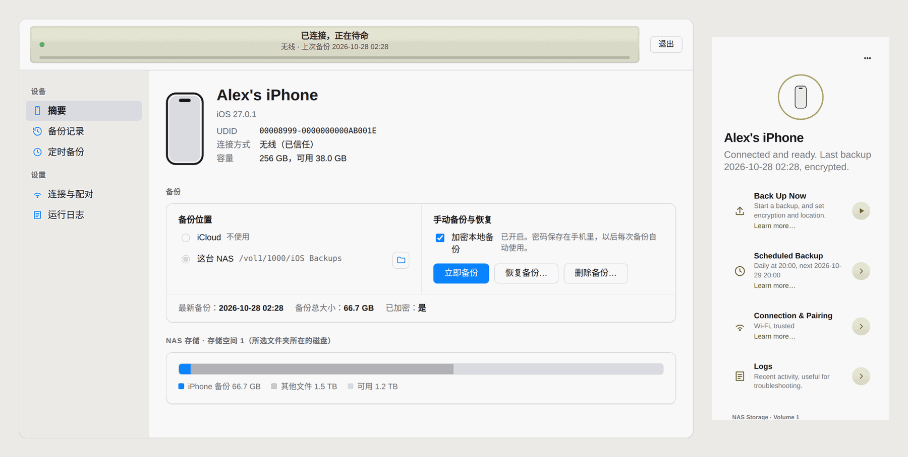</p>

<p align="center"><a href="docs/video/ios-backup-station-demo.mp4">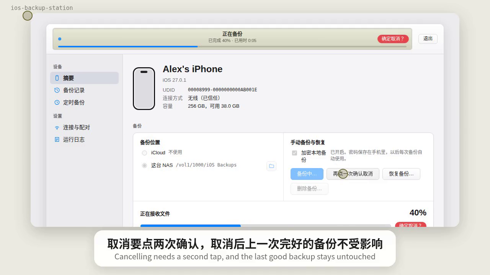</a><br><sub>▶ 观看 3 分钟演示视频（无声，中英文字幕）</sub></p>

> 与苹果公司无关。使用前请先读[免责声明](#5-免责声明和测试配置)，**尤其是“还没有验证过什么”那一段**。

## 目录

1. [简介和出发点](#1-简介和出发点)
2. [怎么安装](#2-怎么安装)
3. [功能一览（截图）](#3-功能一览截图)
4. [需要哪些权限](#4-需要哪些权限)
5. [免责声明和测试配置](#5-免责声明和测试配置)
6. [已知限制](#6-已知限制)
7. [常见问题和排错](#7-常见问题和排错)
8. [怎么恢复备份](#8-怎么恢复备份)
9. [升级、卸载、备份配置](#9-升级卸载备份配置)
10. [安全和隐私](#10-安全和隐私)
11. [和同类方案的区别](#11-和同类方案的区别)
12. [工作原理](#12-工作原理)
13. [开发和测试](#13-开发和测试)
14. [致谢和许可证](#14-致谢和许可证)
15. [请我喝杯咖啡](#15-请我喝杯咖啡)

---

## 1. 简介和出发点

**出发点很简单：我不想把整机备份交给 iCloud，也不想每次都开着电脑、插着线。**

- iCloud 备份只能存到苹果的服务器，容量要另外付费。
- iTunes 或 Finder 的“无线同步”要有一台电脑一直开着。
- 家里已经有 NAS，空间大，一直开机。

所以这个项目让 NAS 自己去备份手机：

- NAS 通过 USB 或 Wi-Fi 连上 iPhone 或 iPad，用的是 [libimobiledevice](https://libimobiledevice.org) 和 usbmuxd2，也就是 iTunes 同一套备份协议。
- 备份可以**加密**，文件夹按手机的 UDID 命名，和 iTunes 或 Finder 的备份目录格式一致，所以需要时可以拷到 Windows 或 Mac 上恢复（见[怎么恢复备份](#8-怎么恢复备份)）。
- 有**网页界面**（电脑版和手机版，iPad 也能用），可以设置备份位置、加密、**定时备份**，看进度和记录。
- 整个东西是**一个 Docker 容器**，用 `docker compose up` 启动。

适合你，如果：家里有一台能跑 Docker 的 NAS 或小主机，有 USB 口，手机和 NAS 在同一个局域网。

## 2. 怎么安装

### 你需要

| 要求 | 说明 |
|---|---|
| 一台 Linux 的 NAS 或小主机 | 测试过 x86_64 的飞牛 fnOS，其他系统见[测试配置](#5-免责声明和测试配置) |
| Docker 和 Docker Compose v2 | `docker compose version` 能运行 |
| 一个 USB 口 | 第一次配对和第一次完整备份建议用 USB |
| 主机上的 avahi（可选） | 只有无线备份需要；没有它仍可用 USB 备份 |
| 一个文件夹 | 放备份用，空间要够（整机备份可能是几十到上百 GB） |

### 最简单：安装脚本

```bash
git clone https://github.com/JerryGHT04/ios-backup-station.git
cd ios-backup-station
./install.sh
```

脚本会：检查 Docker，**推荐剩余空间最大的位置**，确认文件夹存在并且能写，写好 `.env`，启动容器，打印访问地址。第一次需要在 NAS 上从源码构建，大约几分钟。

没有 `.env` 时直接 `docker compose up` 会停下来，并告诉你该填什么：

```text
required variable BACKUP_LOCATION is missing a value: 请先在 .env 里设置 BACKUP_LOCATION，填备份要保存到的 NAS 文件夹的完整路径……
```

### 手动安装

```bash
cp .env.example .env
# 编辑 .env，只有 BACKUP_LOCATION 必须填：备份保存到的、已经存在的文件夹的完整路径
docker compose up -d --build
```

`.env` 里的设置：

| 变量 | 默认 | 作用 |
|---|---|---|
| `BACKUP_LOCATION` | 必填 | 备份保存到哪个 NAS 文件夹，例如 `/vol1/1000/ios-backups` |
| `PORT` | `8899` | 网页端口 |
| `CONFIG_LOCATION` | `./config` | 设置、访问密码、历史记录，**不要删** |
| `LOCKDOWN_LOCATION` | `./lockdown` | 手机的配对记录，**不要删**，删了要重新配对 |
| `APT_MIRROR` | 空 | 构建时下载太慢可以填镜像，例如 `mirrors.ustc.edu.cn` |
| `IBS_IMAGE` | 空 | 预编译镜像（发布后可用），填了就不用在 NAS 上构建 |

### 在 NAS 的 Docker 界面里使用

飞牛 fnOS 上，用上面的命令启动后，项目会自动出现在 Docker 应用的 Compose 列表里，也可以在那里查看和停止。如果要在图形界面里修改 compose，先停止项目；改动的是同一个文件。

### 安装之后（第一次使用）

1. 在同一个局域网的浏览器里打开 `http://NAS的IP:8899`，**设置访问密码**（输两遍，提示词可选）。
2. 用 USB 线把 iPhone 或 iPad 接到 NAS，在设备上点“信任”并输入锁屏密码。
3. 页面会让你**选备份文件夹**（会推荐剩余空间最大的磁盘）。
4. 第一次备份请**用 USB 做完**，并且在这时选择是否加密。
5. 要用无线备份：连着 USB 时在“连接与配对”里点“开启 Wi-Fi 同步”；在手机“设置 → Wi-Fi → 家里的网络 → ⓘ”里**关闭“私有无线局域网地址”**（原因见[常见问题](#7-常见问题和排错)）；拔掉 USB，点“检测连接”。
6. 想要夜里自动备份，到“定时备份”里设置。

页面上的**“环境自检”**会告诉你还有什么没配好（比如备份文件夹没有真正挂载进来）。

## 3. 功能一览（截图）

### 访问密码和语言

第一次打开要设置密码，之后每次进来输入一次。输错两次会显示你设的提示词。手机版的密码页右上角有一个小图标，可以切换简体中文或 English。

<table>
<tr>
<td>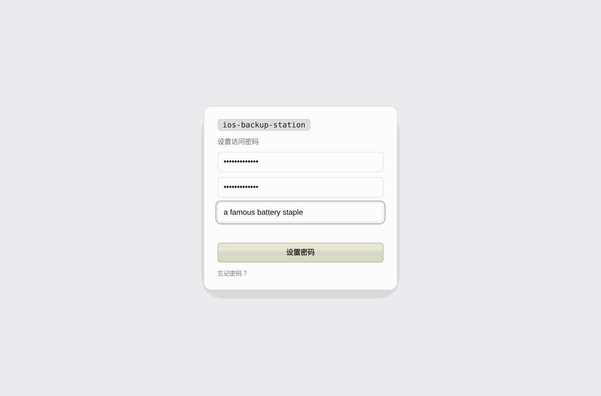</td>
<td>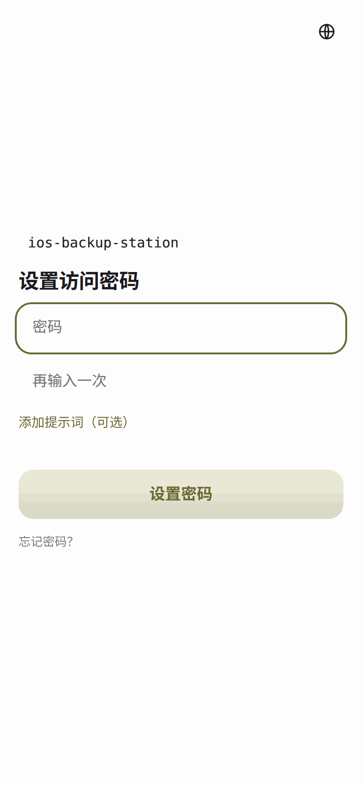</td>
<td>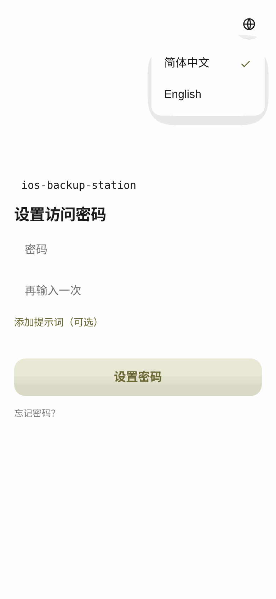</td>
</tr>
</table>

### 摘要和备份

状态条显示连接方式和上次备份。点“立即备份”开始，进度条和手机版的进度环显示**总进度**（不是单个文件的进度），并给出已用时和剩余时间的估计。取消要点两次确认，取消后上一次完好的备份不受影响。

**删除备份**会把所选设备在 NAS 上的整个备份删掉（要先输入确认的字，备份进行中会被拒绝）。电脑版在同时看到不止一台 iPhone 或 iPad 时，设备名右边会出现**切换设备**；有任务在运行时不能切换。

<table>
<tr>
<td>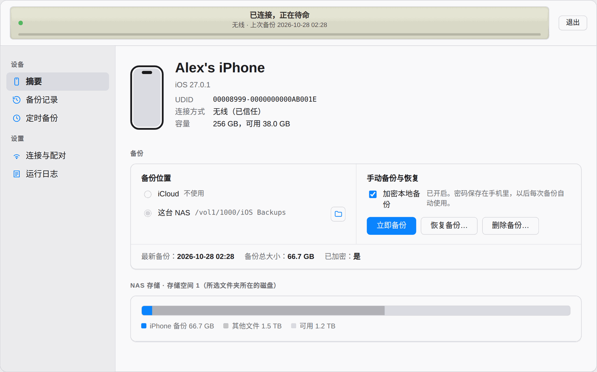</td>
<td>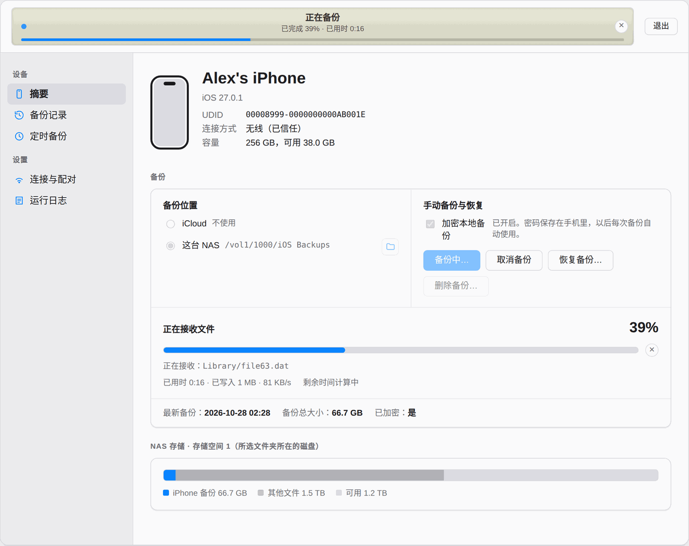</td>
</tr>
</table>

### 备份记录、定时备份、连接与配对

- **备份记录**：每次备份的时间、方式（USB 或无线）、触发（手动或定时）、大小、耗时、是否加密、失败原因。
- **定时备份**：由 NAS 在设定的时间主动连接手机；手机不在线时在你设的窗口内每 10 分钟重试一次；手机锁屏等密码超过 5 分钟就放弃这次。用 NAS 自己的时区。
- **连接与配对**：配对、开启 Wi-Fi 同步、检测连接的步骤，以及“为什么要关闭私有无线局域网地址”的说明。

<table>
<tr>
<td>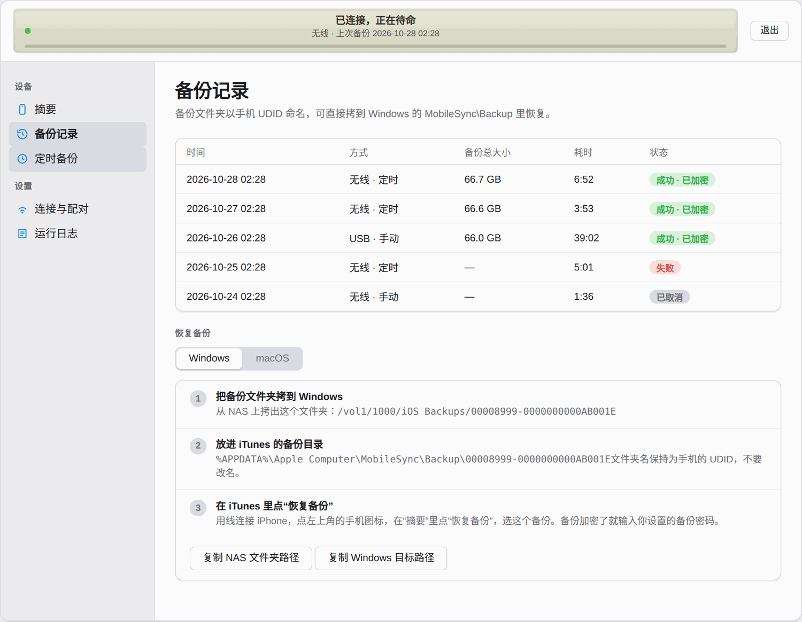</td>
<td>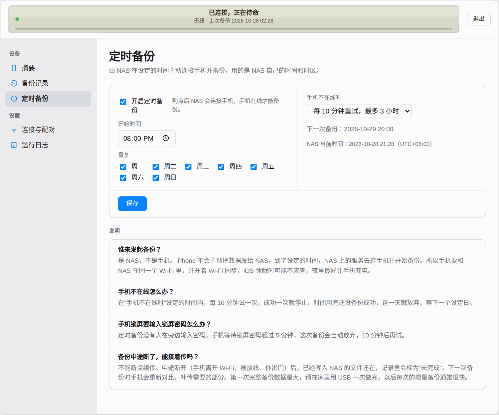</td>
<td>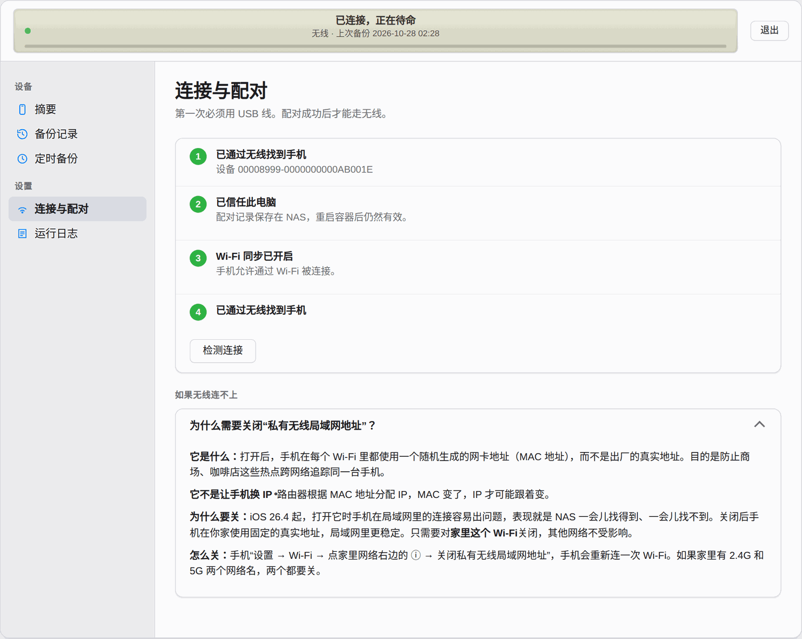</td>
</tr>
</table>

### 选择备份位置和环境自检

文件夹选择器只显示你**共享给容器的文件夹**，可以新建文件夹；每台设备可以各选一个（比如 iPhone 一个、iPad 一个）。自检会在备份文件夹没有真正挂载、配对记录没保存、找不到 USB 或 avahi 时给出提示和修法。

<table>
<tr>
<td>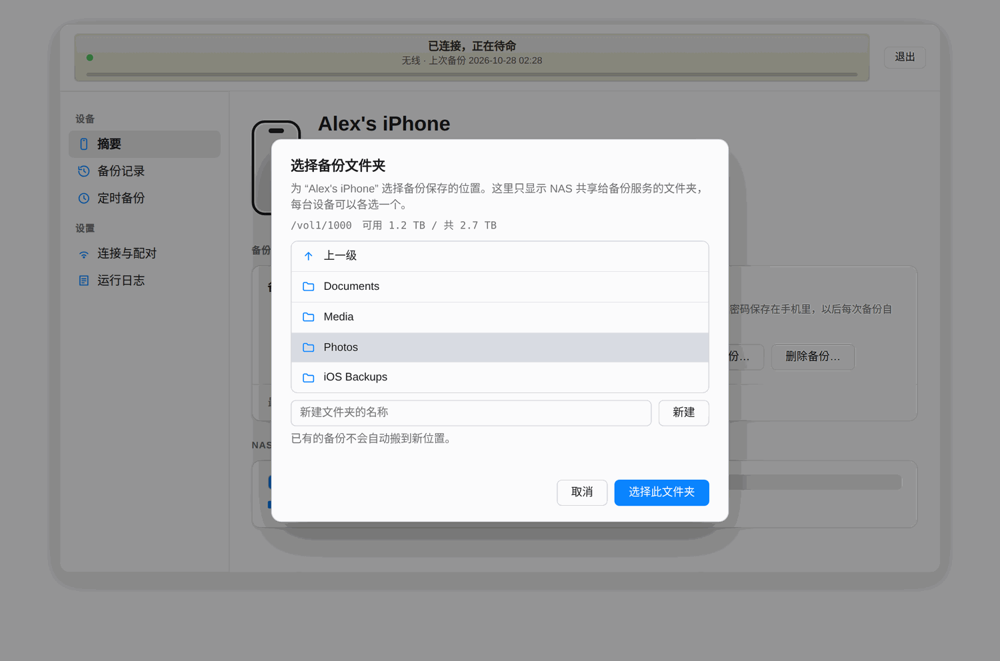</td>
<td>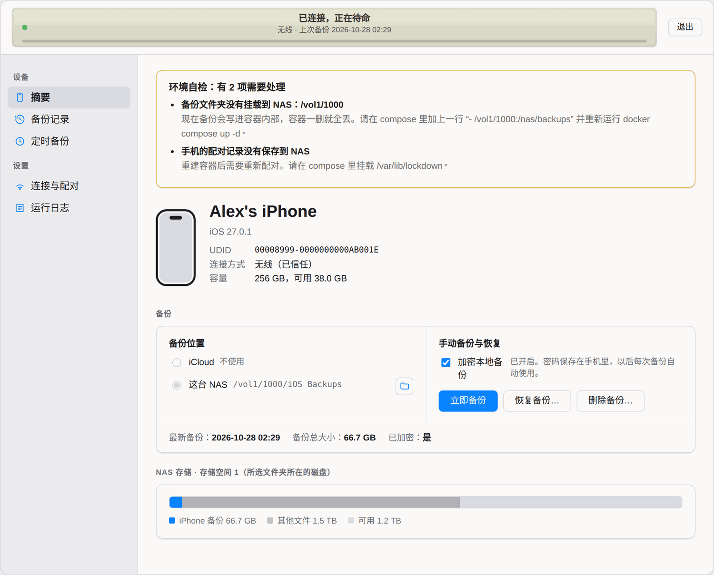</td>
</tr>
</table>

### 手机版和 iPad

手机和 iPad 访问会自动用为触屏设计的界面，布局参考苹果诊断工具：一屏一个重点，进度环，卡片，详情从底部滑出。手机上点“请求桌面网站”则会显示电脑版。手机版有简体中文和 English。

<table>
<tr>
<td>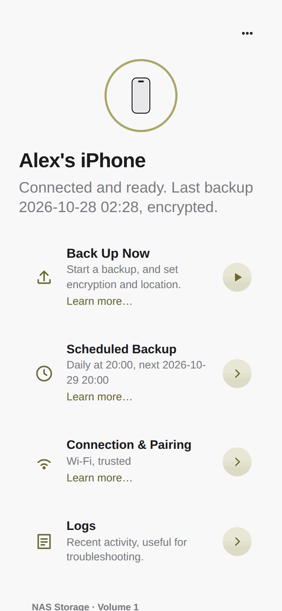</td>
<td>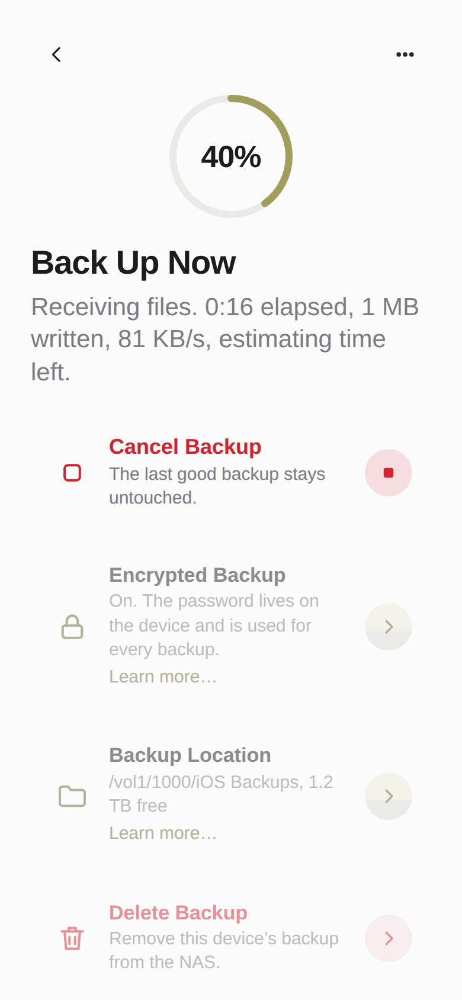</td>
<td>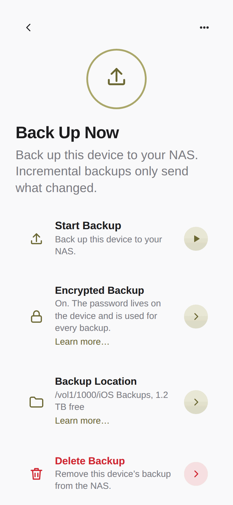</td>
<td>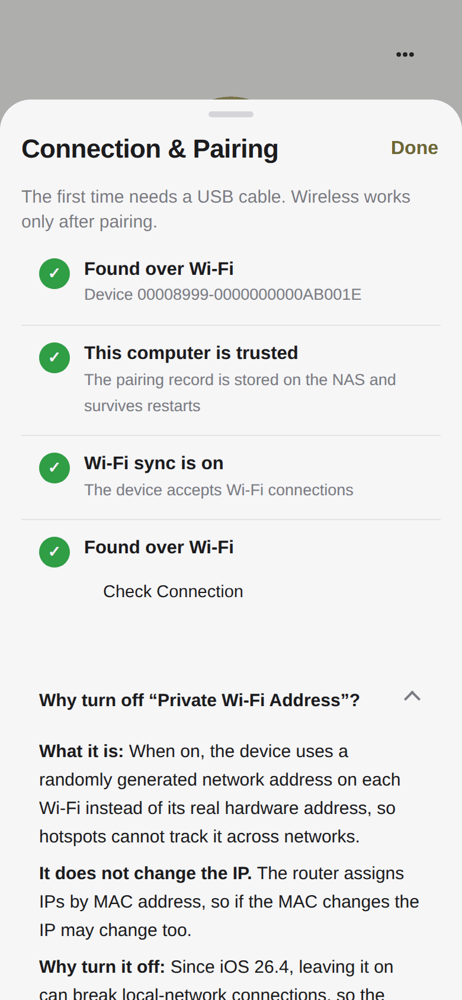</td>
</tr>
</table>

<p align="center">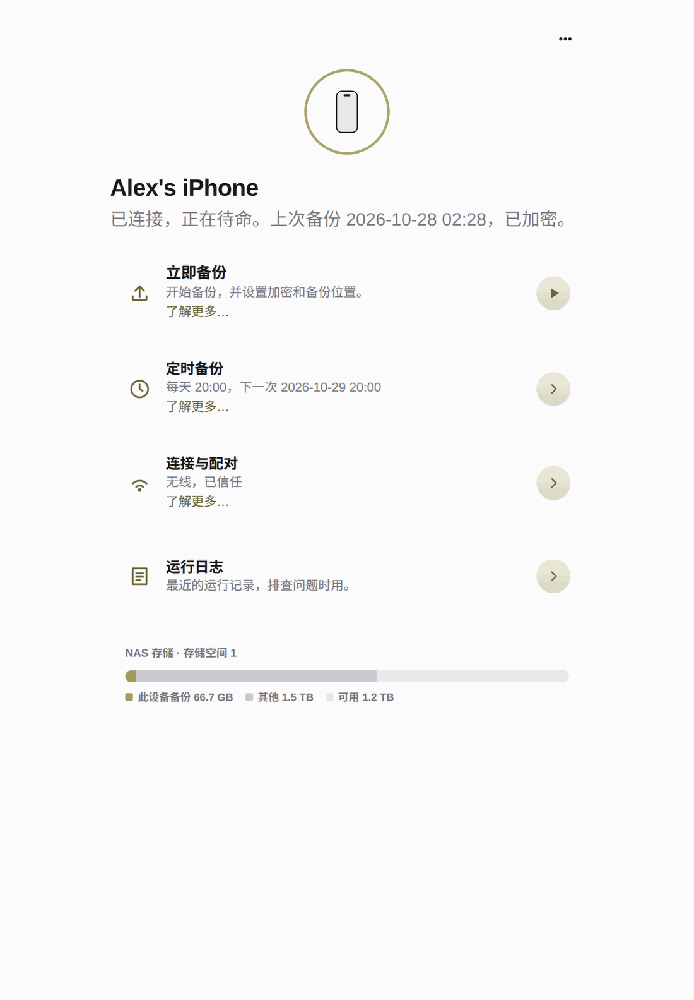</p>

### 没有手机也想先看看界面

```bash
python3 tests/run_demo_server.py     # 打开 http://127.0.0.1:8899 ，密码 demo
```

这是真实的服务加一个假手机和示例数据，退出时全部删除，不会碰其他东西。

## 4. 需要哪些权限

容器要和 USB 设备、局域网、系统的 avahi 打交道，所以权限比普通应用大。**请理解这一点再安装。**

| 设置 | 为什么需要 | 意味着什么 |
|---|---|---|
| `privileged: true` | 读写 USB 设备、让 usbmuxd 工作 | 容器里的程序基本等于 NAS 上的 root，只在可信的局域网里运行，不要暴露到公网 |
| `network_mode: host` | 在局域网里发现手机（mDNS），并复用主机的 avahi | 容器直接使用主机的网络，网页端口（默认 8899）会在主机上打开 |
| `/dev/bus/usb` | USB 配对和备份 | 容器能看到所有 USB 设备 |
| `/run/dbus`、`/run/avahi-daemon` | 通过主机的 avahi 发现 Wi-Fi 上的手机 | 容器能连上主机的 avahi 服务；主机没有 avahi 时只影响无线备份 |
| `/etc/localtime`（只读） | 定时备份用 NAS 自己的时区 | 无 |
| `BACKUP_LOCATION`（读写） | 保存备份 | 容器可以在这个文件夹里读写，别的文件夹看不到 |
| `./config`、`./lockdown`（读写） | 保存设置、访问密码的哈希、配对记录 | `lockdown` 里有手机的信任密钥，当作密码对待，不要拷到别处 |

容器以 root 运行。运行时**不需要访问互联网**（构建时需要从 GitHub 和 Debian 下载）。程序**不发送任何统计信息**。

## 5. 免责声明和测试配置

**免责声明**

- 这是个人业余项目，按“现状”提供，**不提供任何担保**（见 [LICENSE](LICENSE)）。
- 与苹果公司无关，也没有得到苹果的授权或认可。iPhone、iPad、iOS、iTunes、Finder、macOS 是苹果公司的商标，这里只是用来说明软件支持哪些设备和程序。
- 备份里有你最私密的数据（照片、消息、健康数据、密码）。**请开启加密，保管好备份密码，并定期做一次恢复测试。** 忘记备份密码就无法恢复。
- 它调用的是第三方库实现的备份协议。苹果更新 iOS 后，协议可能有变化，导致备份失败或备份不完整。
- 出现数据丢失，作者不负责。

**已经测试过的配置（作者的环境）**

| 项目 | 内容 |
|---|---|
| NAS | 飞牛 fnOS（内核 6.18），x86_64，12 核，15.5 GiB 内存，btrfs 存储 |
| Docker | Docker 28.5.2，Compose v2.40.3，基础镜像 Debian 13（trixie） |
| 设备 | iPhone Air（`iPhone18,4`），iOS 27.0.1，USB-C；另用 iPad 打开网页界面 |
| 网络 | 路由器同时提供 2.4G 和 5G，NAS 有线接入 |
| 浏览器 | iPhone 和 iPad 的 Safari，另用 Linux 上的 Chrome 做自动化测试 |
| 资源占用 | 待机时约占一个核心的 1%，内存约 19 MiB |

**在真机上已经验证的**：USB 识别和配对；开启 Wi-Fi 同步；无线发现手机，并能在 USB 和无线之间切换；开启备份加密；用手机和 iPad 打开网页界面；开始和取消备份；**在 Wi-Fi 和 USB 上各完整做完一次加密备份**（iPhone 约 131 GB，iPad 约 33 GB）；删除备份；以及**手机接受备份密码并开始解包备份**（`idevicebackup2 unback`，两分钟后停止）。

**还没有验证的（请不要假设它们一定可用）**

- **用做出来的备份真的恢复一次手机。** 文件夹格式与 iTunes、Finder 一致，手机也能用密码解锁并开始读取备份，但**没有**完整恢复过一台手机，也没有把整份备份完整解包过。
- 夜里无人值守的定时备份（尤其手机锁屏时是否需要密码）。
- 恢复 iPad。（备份 iPad 是可用的。）
- 手机上点“请求桌面网站”后自动显示电脑版、iPad 自动用手机版布局：判断逻辑在模拟环境里测过，真机上的表现作者还没有逐项确认。
- 其他品牌的 NAS（群晖、威联通、Unraid、TrueNAS……）、arm64、其他 iOS 版本。

**自动化测试**（不需要真机，用一套假的 libimobiledevice 命令跑真实的服务代码）：接口层 34 项，浏览器层 12 项（登录、各个界面、取消、XSS、各种屏幕宽度不溢出、控件有名字），纯逻辑 26 项（定时、看门狗、进度解析、自检）。详见[开发和测试](#13-开发和测试)。这些测试能抓到我们自己的逻辑错误，但**不能代替真机**。

## 6. 已知限制

- **没有断点续传。** 备份中途断开（手机离开 Wi-Fi、拔线、出门），已写入的文件还在，但下次备份时手机会重新对比并补传，被打断的那一部分要重新传。第一次完整备份请在家里用 USB 一次做完。
- **一次只处理一台设备。** 同时看到多台设备时，用设备名右边的切换来选（电脑版，手机版还没有）。备份不会并行进行，**定时备份只对当前选中的设备生效**。每台设备的备份文件夹和定时设置是分开保存的。
- **锁屏时可能需要锁屏密码。** 手机重启后第一次解锁之前，备份一定会要求密码；其他情况下是否需要，取决于手机，作者还没在夜间实测过。
- **不能浏览单个文件。** 这是整机备份，只能整个恢复。
- **手机上不能恢复。** 恢复要在 Windows 的 iTunes 或 Mac 的 Finder 里做。
- **电脑版界面目前只有中文。** 手机版有简体中文和 English；电脑版的英文在计划中。
- **网页是 HTTP，没有 TLS。** 只适合局域网，见[安全和隐私](#10-安全和隐私)。
- **无线备份比 USB 慢，而且占用 Wi-Fi 带宽。** 建议夜里做。
- iOS 26.4 起有手机侧的局域网连接问题，需要关闭“私有无线局域网地址”。

## 7. 常见问题和排错

**页面上“环境自检”提示备份文件夹没有挂载**
容器里看不到你的文件夹，备份会写进容器内部，容器一删就丢。检查 `.env` 里的 `BACKUP_LOCATION` 是不是真实存在的路径，然后 `docker compose up -d` 重新创建容器。

**NAS 找不到手机（无线）**
1. 手机和 NAS 在同一个网段吗？访客网络和有些“IoT 网络”会隔离设备。
2. 手机的 Wi-Fi 同步开了吗？（连着 USB 时点“开启 Wi-Fi 同步”。）
3. 关闭家里 Wi-Fi 的**“私有无线局域网地址”**（设置 → Wi-Fi → 家里的网络右边的 ⓘ）。iOS 26.4 起，打开它时手机在局域网里的连接容易出问题，表现是 NAS 一会儿找得到、一会儿找不到。2.4G 和 5G 如果名字不同，两个都要关。
4. 手机熄屏休眠时可能不应答。让它充电，或先点亮屏幕再点“检测连接”。
5. 主机上有 avahi 吗？“环境自检”会提示。

**换了 Wi-Fi 频段，或者插拔 USB 之后，网页显示的连接方式不对**
usbmuxd2 有时不会重新发现设备，所以服务里有两个“看门狗”：USB 上有设备但没被列出，3 秒后重启 usbmuxd2；手机在局域网里但没被列出，约 8 秒后重启（刚拔掉 USB 的 20 秒内只等 1 秒）。真机上重启 usbmuxd2 要二十秒左右，所以整个过程可能要半分钟。也可以点“检测连接”主动触发。

**备份一开始就卡在“请在手机上输入锁屏密码”**
手机在等你解锁并输入锁屏密码。定时备份没有人在旁边，等超过 5 分钟会自动放弃，之后重试。

**忘记访问密码**
在 NAS 上删除项目文件夹里的 `config/auth.json`，重启容器，再打开网页重新设置。这**不影响**备份和手机上的备份密码。

**忘记备份密码**
没有办法找回，这是 iOS 的设计。请把备份密码存进密码管理器。

**构建很慢或失败**
下载 deb.debian.org 慢的话，在 `.env` 里设置 `APT_MIRROR`（例如 `mirrors.ustc.edu.cn`）。Docker 镜像加速站偶尔会返回 401，重试一次通常就好。

**时间不对**
定时备份用 NAS 的时区，compose 里挂载了 `/etc/localtime`。在 NAS 上运行 `date` 看看对不对。

## 8. 怎么恢复备份

恢复要在电脑上做，手机不能直接从 NAS 恢复。

**Windows（iTunes）**

1. 把 NAS 上的备份文件夹（名字是手机的 UDID）拷到 Windows。
2. 放进 `%APPDATA%\Apple Computer\MobileSync\Backup\`，**文件夹名不要改**。
3. 用线连接 iPhone，在 iTunes 里点左上角手机图标，在“摘要”里点“恢复备份”，选这个备份；备份加密了就输入备份密码。

**macOS（Finder）**

1. 把备份文件夹拷到 Mac（在 Finder 里“前往 → 连接服务器”连上 NAS）。
2. 在 Finder 里按 ⇧⌘G，粘贴 `~/Library/Application Support/MobileSync/Backup/`，把文件夹拖进去，名字不要改。
3. 用线连接 iPhone，在 Finder 左侧点这台 iPhone，在“通用”里点“恢复备份…”，选这个备份。
4. macOS Mojave 及更早的系统用 iTunes，步骤和 Windows 一样。

页面的“备份记录”里有这些路径的一键复制。**请在真的需要之前，先用一台备用机或一次不重要的恢复试一遍。**

## 9. 升级、卸载、备份配置

**升级**

```bash
git pull
docker compose up -d --build     # 或者设了 IBS_IMAGE 就用：docker compose pull && docker compose up -d
```

`config` 和 `lockdown` 文件夹不受影响，密码和配对都在。

**卸载**

```bash
docker compose down              # 删除容器；备份文件夹和 config、lockdown 都还在
docker rmi ios-backup-station    # 删除镜像（可选）
```

要彻底删除，再手动删除备份文件夹、`config` 和 `lockdown`。

**备份这个项目自己的配置**
把 `config` 和 `lockdown` 两个文件夹拷走就够了：里面有设置、访问密码的哈希、历史记录和手机的配对记录。**`lockdown` 含有信任密钥，请当作密码保管。**

## 10. 安全和隐私

- **所有数据只在你的局域网和 NAS 里**，程序不联网、不上报。
- **访问密码**：用 PBKDF2-SHA256（20 万次）加盐存哈希，不存明文；登录状态用签名的 cookie（HttpOnly，SameSite=Lax），保持 30 天；同一个地址连续输错 10 次会被锁一分钟；提示词只在输错两次后才显示。
- **备份密码**不在 NAS 上保存：它只在你开启或关闭加密的那一刻经过服务（通过环境变量传给备份工具），之后保存在手机里。日志里不会出现它（有测试检查）。
- **网页是明文 HTTP**，局域网里的其他设备理论上能截获密码。不要把端口映射到公网。需要的话，放在带 HTTPS 的反向代理后面。
- 网页界面里来自设备或文件夹的文字都按纯文本显示，不会被当成 HTML 执行（有测试检查）。
- 这个容器是特权容器（见[需要哪些权限](#4-需要哪些权限)）。

发现安全问题请通过 Issue 联系，如果涉及严重漏洞，请先私下联系维护者。

## 11. 和同类方案的区别

下表只是我对公开介绍页的理解，没有逐项试用；如有不准确欢迎指正。

| | ios-backup-station | iTunes/Finder 无线同步 | [AirVault](https://ca.unraid.net/apps/airvault-1wgjo0w039uoj0) | [iosbackup](https://www.v2ex.com/t/1139025) |
|---|---|---|---|---|
| 备份位置 | 你的 NAS | 电脑 | 你的 NAS（Unraid 模板） | 你的 NAS |
| 需要电脑一直开着 | 否 | 是 | 否 | 否 |
| 开源 | 是（MIT） | 否 | 否（个人免费，商用需授权） | 以其介绍为准 |
| 网页界面 | 电脑版和手机版，iPad | — | 有 | 以其介绍为准 |
| 定时备份 | 有（NAS 主动发起，时间窗口重试） | 手机充电时自动 | 以其介绍为准 | 手机进入 Wi-Fi 时触发 |
| 备份格式 | iTunes 格式 | iTunes 格式 | 以其介绍为准 | 以其介绍为准 |
| 自带自检、自动化测试 | 有 | — | — | — |

选它的理由主要是：开源、能在 NAS 上一键部署、iTunes 能恢复的格式、有自检。**选别的方案的理由**：如果你要的是更成熟、更多人用的方案，或者你用 Unraid，AirVault 可能更省事。

## 12. 工作原理

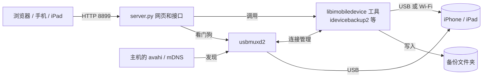

- `app/server.py`：用 Python 标准库写的网页服务，没有第三方依赖。它**调用命令行工具**，解析输出里的总进度，管理任务、定时和看门狗。
- `app/static/index.html`、`mobile.html`：两套界面，都是单个文件，没有构建步骤。
- `tools/wifi_sync.c`：一个很小的工具，用来打开手机的“Wi-Fi 同步”（标准工具里没有）。
- `Dockerfile`：从上游源码构建 libimobiledevice 一套库和 usbmuxd2（见[致谢](#14-致谢和许可证)）。

## 13. 开发和测试

不需要真机。`tests/fakephone/` 是一组假的 libimobiledevice 命令，由一个状态文件控制（拔插 USB、掉线、锁屏、备份失败……），真实的服务代码在上面运行。

```bash
python3 -I tests/test_logic.py                # 纯逻辑，不到 1 秒
python3 -I tests/test_backend.py              # 接口层，约 4 分钟（其中一项要等定时器触发）
pip install playwright pillow                 # 浏览器测试用本机的 Chrome
python3 -I tests/test_ui.py                   # 浏览器层，约 2 分钟
python3 tests/run_demo_server.py              # 带示例数据的演示
python3 tests/make_screenshots.py             # 重新生成 docs/images 里的截图
```

测试已经抓到过的真实问题包括：备份结束时的一行日志写错导致任务状态清不掉、参数没传导致所有备份失败、GET 请求带空字符会让处理线程崩溃、对话框按 Esc 关不掉、进度条把单个文件的进度当成总进度。

## 14. 致谢和许可证

本项目的代码使用 [MIT 许可证](LICENSE)。

它依赖下面这些项目，镜像里包含它们，各自有自己的许可证（详见 [THIRD_PARTY_NOTICES.md](THIRD_PARTY_NOTICES.md)）：

- [libimobiledevice](https://github.com/libimobiledevice/libimobiledevice)（含 `idevicebackup2`）、libplist、libusbmuxd、libimobiledevice-glue、libtatsu：LGPL-2.1
- [usbmuxd2](https://github.com/tihmstar/usbmuxd2) 和 libgeneral（tihmstar）：LGPL-3.0 和 LGPL-2.1
- Debian 基础镜像和软件包

感谢这些项目的作者，没有他们就没有这个项目。

## 15. 请我喝杯咖啡

这个项目免费，用 MIT 协议开源，不付费也能完整使用。如果它帮你省了些麻烦，想请我喝杯咖啡，可以用微信扫下面的码。完全自愿，不会有额外的功能或支持。

<p align="center"></p>
